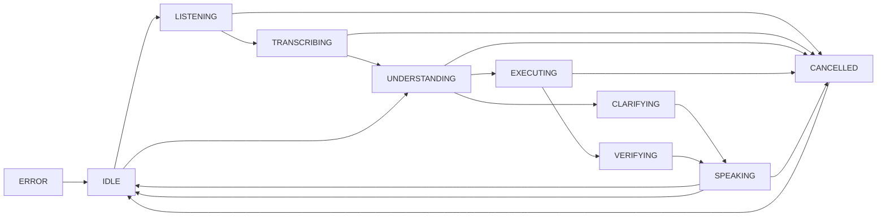

# AURA EDGE — System Architecture (Phase 0 – Phase 4)

## Phase 4 Personal Secretary & Shared Multilingual Grounding

Part A & Phase 4 extend the offline modular monolith with unified code-switched EN/HI/KN/Hinglish/Kanglish normalization and execution grounding alongside PostgreSQL-backed personal tasks, offline calendar (with conflict detection & recurrence), daily briefings, household groceries/recipes, exact-paise expense tracking, and cached parcel records (`0005_phase4_personal_assistant`).

## 1. Architectural Pattern

AURA EDGE uses a **layered modular monolith** combined with an **event-driven automation & voice pipeline**. One deployable core FastAPI application houses bounded modules backed by local supporting processes (PostgreSQL 16 + `pgvector`, local Ollama, and offline ONNX/CTranslate2 speech runtimes).

> **Scope Status:** **Phases 0, 1, 1.5, 2, 3, and Phase 4 core Personal Secretary modules** (tasks, offline calendar, daily briefing, groceries/recipes, expenses/CSV import, and cached parcels + Part A multilingual grounding) are implemented on `feat/backend-intelligence`. Optional local document RAG/desktop launcher and Phase 6 external online connectors remain deferred.

## 2. Module Layout (`backend/src/aura_edge/`)

| Layer | Module / Path | Responsibility |
|---|---|---|
| **Configuration** | `config.py` | Loads `AURA_EDGE_*` settings; defaults to `strict_offline` and `Asia/Kolkata` timezone; configures `nomic-embed-text:latest` (`dim=768`), scheduler poll/grace intervals, and notification audio queue capacity; rejects SQLite/non-PostgreSQL URLs. |
| **Infrastructure** | `infrastructure/network_policy.py`, `hardware.py`, `compute.py` | Fail-closed `NetworkPolicyEnforcer`, host CPU/RAM/GPU telemetry, `ComputeManager` (`auto` \| `cpu` \| `gpu`), Windows CUDA DLL handle caching. |
| **Speech** | `speech/audio_capture.py`, `vad.py`, `stt.py`, `playback.py`, `tts_router.py` | 16 kHz PortAudio capture with half-duplex suspension & sticky user mute, CPU Silero VAD (`onset_frames=2`), decoupled multilingual STT (`faster-whisper` + mixed-script preservation + selective `indic-conformer-kn`), R4 noise/silence gate, lock-free SPSC PCM playback & `sherpa-onnx` EN/HI/KN TTS. |
| **Intelligence** | `intelligence/normalizer.py`, `fast_router.py`, `planner.py`, `conversation.py`, `embedder.py`, `response_catalog.py` | Code-switched EN/HI/KN/Hinglish/Kanglish normalizer (transliterated English numbers/units + script-count language precedence), deterministic `MultilingualFastRouter` (Phase 1–4 tools), `HybridPlanner` (operational grounding gate & boolean coercion), `ConversationSession` (verified-entity anaphora + post-delete memory scrubbing + `validate_no_unverified_action_claim`), and CPU-only loopback `LocalEmbedder`. |
| **Application** | `application/smart_home.py`, `memory_service.py`, `scheduler_service.py`, `notification_service.py`, `personal/*`, `voice_orchestrator.py` | Capability-validated `SmartHomeService`; `MemoryService`; `SchedulerService`; `NotificationService`; Phase 4 `TaskService`, `CalendarService`, `BriefingService`, `GroceryService`, `ExpenseService`, and `ParcelService`; and `VoiceOrchestrator`. |
| **Execution** | `execution/state_machine.py`, `tool_registry.py`, `tools/` | 10-state `AssistantStateMachine`, `ToolRegistry` enforcing schema/capability validation and verified state post-checks across Phase 1–4 intents, `DateTimeTool`, and `TimerManager`. |
| **Data** | `data/models.py`, `database.py`, `repositories/{timer,memory,scheduler,notification,personal}_repo...` | SQLAlchemy 2.0 ORM and Alembic revisions `0001`–`0005` (`tasks`, `calendar_events`, `grocery_items`, `shopping_list_items`, `local_recipes`, `expense_imports`, `expense_transactions`, `parcels`). |
| **API** | `api/routes_{health,voice,timers,smart_home,memory,scheduler,notifications,personal}.py`, `ws_events.py`, `main.py` | REST endpoints and `/api/v1/ws/live` WebSocket hub with ordered startup/shutdown lifespan and offline recipe seeding. |

## 3. 10-State Voice Turn Lifecycle

## 4. Connectivity Contract

| Mode | Default? | Permitted Targets | Denied Targets |
|---|---|---|---|
| `strict_offline` | **Yes** | Loopback only (`127.0.0.1`, `::1`, `localhost`) | All public domains/IPs, RFC1918 LAN IPs, link-local metadata (`169.254.0.0/16`), non-loopback bind hosts; `HF_HUB_OFFLINE=1` enforced |
| `lan_only` | No | Loopback + configured private RFC1918 CIDRs (`AURA_EDGE_LAN_ALLOWED_CIDRS`) | Public internet domains/IPs, link-local metadata, multicast/unspecified IPs |
| `online_opt_in` | No | Loopback + configured LAN + exact hostnames in `AURA_EDGE_ONLINE_ALLOWED_HOSTS` | Unlisted external hosts, link-local metadata, multicast/unspecified IPs |
