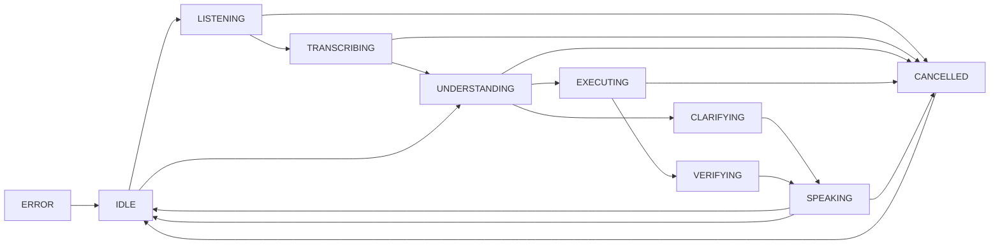

# AURA EDGE — System Architecture (Phase 0 + Phase 1)

## 1. Architectural Pattern

AURA EDGE uses a **layered modular monolith** combined with an **event-driven automation & voice pipeline**. One deployable core FastAPI application houses bounded modules backed by local supporting processes (PostgreSQL 16 + `pgvector`, local Ollama, and offline ONNX/CTranslate2 speech runtimes).

> **Scope Status:** **Phase 0 (Foundation)** and **Phase 1 (Multilingual Voice, Local Tools, 10-State FSM, CPU/GPU Compute)** are implemented and verified on `feat/backend-intelligence`. Phase 2+ smart-home device simulators, MQTT adapters, memory/RAG, and external connectors remain reserved boundaries.

## 2. Module Layout (`backend/src/aura_edge/`)

| Layer | Module / Path | Responsibility |
|---|---|---|
| **Configuration** | `config.py` | Loads `AURA_EDGE_*` settings; defaults to `strict_offline`; enforces loopback bind host in strict mode; rejects SQLite/non-PostgreSQL URLs; sets `HF_HUB_OFFLINE=1` & `TRANSFORMERS_OFFLINE=1` when offline/LAN. |
| **Infrastructure** | `infrastructure/network_policy.py` | Centralized fail-closed `NetworkPolicyEnforcer` + `PolicyEnforcingTransport` / `AsyncPolicyEnforcingTransport` for `httpx` (`strict_offline`, `lan_only`, `online_opt_in`) without external DNS lookups. |
| **Infrastructure** | `infrastructure/hardware.py` | Measured host CPU/RAM (`psutil`), NVIDIA GPU/VRAM (`pynvml`), and loopback Ollama (`GET /api/tags`) via `NetworkPolicyEnforcer`. |
| **Infrastructure** | `infrastructure/compute.py` | `ComputeManager` (`auto` \| `cpu` \| `gpu`), Windows `torch\lib` CUDA DLL handle retention (`_DLL_DIR_HANDLES`), and explicit fallback reporting (`fallback_reason`). |
| **Speech** | `speech/audio_capture.py`, `speech/vad.py` | PortAudio (`sounddevice`) 16 kHz mono capture, 3s pre-roll `deque`, zero-inference callback -> bounded `queue.Queue`, `AudioRouteMode` self-trigger prevention, CPU Silero VAD ONNX (`3.0s` initial timeout, `1.2s` trailing silence). |
| **Speech** | `speech/stt.py` | Thread-safe offline `WhisperTranscriber` (`faster-whisper`, `local_files_only=True`), `repetition_penalty=1.2`, CPU `int8` / CUDA `int8_float16` placement & fallback, EN/HI/KN language detection/locking. |
| **Speech** | `speech/tts_router.py`, `tts_backends/`, `playback.py` | Language-aware `TTSRouter` (`sherpa-onnx` CPU Piper EN/HI + MMS-TTS ONNX KN, Windows SAPI5 EN fallback), `OrderedDict` LRU cache, multilingual sentence splitter (`।॥.!?`), lock-safe `OutputStream` prefetch & 64-sample fade-out barge-in. |
| **Intelligence** | `intelligence/normalizer.py`, `fast_router.py`, `intents/` | Unicode-safe normalizer (preserves Devanagari `\u0900-\u097F` & Kannada `\u0C80-\u0CFF`, translates Indic digits, handles Hinglish/Kanglish), `OHF-Voice/hassil` YAML grammars, compound-clause validation, safe refusal. |
| **Intelligence** | `intelligence/ollama_client.py`, `planner.py`, `response_catalog.py` | Policy-wrapped `OllamaClient` (`qwen3.5:4b`, `num_ctx=4096`, `num_gpu=0` in CPU mode, NDJSON streaming, `asyncio.Lock`), strict JSON schema validation preventing hallucinated tools/devices, EN/HI/KN templates. |
| **Execution** | `execution/state_machine.py`, `tool_registry.py`, `tools/` | 10-state `AssistantStateMachine` (`IDLE`..`ERROR`) with `TurnContext` cancel tokens & stale-turn guards; `DateTimeTool`; `TimerManager` (PostgreSQL-backed, startup recovery, duplicate prevention); reserved Phase 2 extension hook. |
| **Application** | `application/voice_orchestrator.py` | Coordinates PTT capture, audio upload transcription, text intent execution, turn cancellation, timer announcements, and `voice_turn_metrics` persistence. |
| **Data** | `data/models.py`, `database.py`, `repositories/timer_repo.py` | SQLAlchemy 2.0 ORM (`system_settings`, `connectivity_audit_events`, `phase0_vector_smoke`, `timers`, `voice_turn_metrics`), Alembic migrations `0001` & `0002`. |
| **API** | `api/routes_health.py`, `routes_voice.py`, `routes_timers.py`, `ws_events.py`, `main.py` | Phase 0 health/readiness/policy endpoints + Phase 1 voice, synthesis, timer CRUD, and `/api/v1/ws/live` WebSocket hub. |

## 3. 10-State Voice Turn Lifecycle

## 4. Connectivity Contract

| Mode | Default? | Permitted Targets | Denied Targets |
|---|---|---|---|
| `strict_offline` | **Yes** | Loopback only (`127.0.0.1`, `::1`, `localhost`) | All public domains/IPs, RFC1918 LAN IPs, link-local metadata (`169.254.0.0/16`), non-loopback bind hosts; `HF_HUB_OFFLINE=1` enforced |
| `lan_only` | No | Loopback + configured private RFC1918 CIDRs (`AURA_EDGE_LAN_ALLOWED_CIDRS`) | Public internet domains/IPs, link-local metadata, multicast/unspecified IPs |
| `online_opt_in` | No | Loopback + configured LAN + exact hostnames in `AURA_EDGE_ONLINE_ALLOWED_HOSTS` | Unlisted external hosts, link-local metadata, multicast/unspecified IPs |
