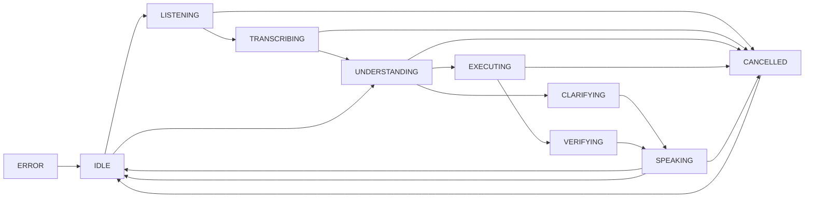

# AURA EDGE — System Architecture (Phase 0 – Phase 3)

## Phase 3 Persistent Memory, Scheduling, Custom Routines & Notifications

Phase 3 extends the offline modular monolith with PostgreSQL + `pgvector` personal memory, a PostgreSQL-backed persistent scheduler (`FOR UPDATE SKIP LOCKED` + unique occurrence deduplication), custom conditional/event-triggered smart-home routines, and persistent proactive notifications with bounded serialized audio playback.

## 1. Architectural Pattern

AURA EDGE uses a **layered modular monolith** combined with an **event-driven automation & voice pipeline**. One deployable core FastAPI application houses bounded modules backed by local supporting processes (PostgreSQL 16 + `pgvector`, local Ollama, and offline ONNX/CTranslate2 speech runtimes).

> **Scope Status:** **Phase 0 (Foundation), Phase 1 (Voice/Timers), Phase 1.5 (Natural Conversation/Streaming), Phase 2 (Smart-Home Simulator), and Phase 3 (Persistent Memory, Scheduling, Routines, Notifications)** are implemented on `feat/backend-intelligence`. Phase 4+ personal productivity domains (tasks/groceries/expenses/parcels/RAG) and Phase 6 external connectors remain deferred.

## 2. Module Layout (`backend/src/aura_edge/`)

| Layer | Module / Path | Responsibility |
|---|---|---|
| **Configuration** | `config.py` | Loads `AURA_EDGE_*` settings; defaults to `strict_offline` and `Asia/Kolkata` timezone; configures `nomic-embed-text:latest` (`dim=768`), scheduler poll/grace intervals, and notification audio queue capacity; rejects SQLite/non-PostgreSQL URLs. |
| **Infrastructure** | `infrastructure/network_policy.py`, `hardware.py`, `compute.py` | Fail-closed `NetworkPolicyEnforcer`, host CPU/RAM/GPU telemetry, `ComputeManager` (`auto` \| `cpu` \| `gpu`), Windows CUDA DLL handle caching. |
| **Speech** | `speech/audio_capture.py`, `vad.py`, `stt.py`, `playback.py`, `tts_router.py` | 16 kHz PortAudio capture with half-duplex suspension & sticky user mute, CPU Silero VAD (`onset_frames=2`), decoupled multilingual STT (`faster-whisper` + selective `indic-conformer-kn`), R4 noise/silence gate, lock-free SPSC PCM playback & `sherpa-onnx` EN/HI/KN TTS. |
| **Intelligence** | `intelligence/normalizer.py`, `fast_router.py`, `planner.py`, `conversation.py`, `embedder.py`, `response_catalog.py` | EN/HI/KN normalizer, deterministic `MultilingualFastRouter` (clock, timers, smart-home, memory, reminders, schedules), `HybridPlanner` (Qwen 3.5 4B tool JSON fallback), bounded `ConversationSession`, and CPU-only loopback `LocalEmbedder` (`nomic-embed-text:latest`, fallback to keyword search). |
| **Application** | `application/smart_home.py`, `memory_service.py`, `scheduler_service.py`, `notification_service.py`, `voice_orchestrator.py` | Capability-validated `SmartHomeService` + custom/conditional routines + simulator event triggers; `MemoryService` (safety filter, structured appliance preferences, 3-tier exact/keyword/`pgvector` retrieval); `SchedulerService` (`Asia/Kolkata` recurrence, missed-job & crash recovery); `NotificationService` (DB-first persist, dedup, quiet hours, bounded audio queue); `VoiceOrchestrator`. |
| **Execution** | `execution/state_machine.py`, `tool_registry.py`, `tools/` | 10-state `AssistantStateMachine`, `ToolRegistry` enforcing schema/capability validation and verified state post-checks across Phase 1–3 intents, `DateTimeTool`, and `TimerManager`. |
| **Data** | `data/models.py`, `database.py`, `repositories/{timer,memory,scheduler,notification}_repo.py` | SQLAlchemy 2.0 ORM and Alembic revisions `0001`–`0004` (`memory_items`, `memory_settings`, `conversation_history_items`, `scheduled_jobs`, `job_executions`, `notifications`, `notification_preferences`, extended `smart_home_routines`). |
| **API** | `api/routes_{health,voice,timers,smart_home,memory,scheduler,notifications}.py`, `ws_events.py`, `main.py` | REST endpoints and `/api/v1/ws/live` WebSocket hub with ordered startup/shutdown lifespan. |

## 3. 10-State Voice Turn Lifecycle

## 4. Connectivity Contract

| Mode | Default? | Permitted Targets | Denied Targets |
|---|---|---|---|
| `strict_offline` | **Yes** | Loopback only (`127.0.0.1`, `::1`, `localhost`) | All public domains/IPs, RFC1918 LAN IPs, link-local metadata (`169.254.0.0/16`), non-loopback bind hosts; `HF_HUB_OFFLINE=1` enforced |
| `lan_only` | No | Loopback + configured private RFC1918 CIDRs (`AURA_EDGE_LAN_ALLOWED_CIDRS`) | Public internet domains/IPs, link-local metadata, multicast/unspecified IPs |
| `online_opt_in` | No | Loopback + configured LAN + exact hostnames in `AURA_EDGE_ONLINE_ALLOWED_HOSTS` | Unlisted external hosts, link-local metadata, multicast/unspecified IPs |
