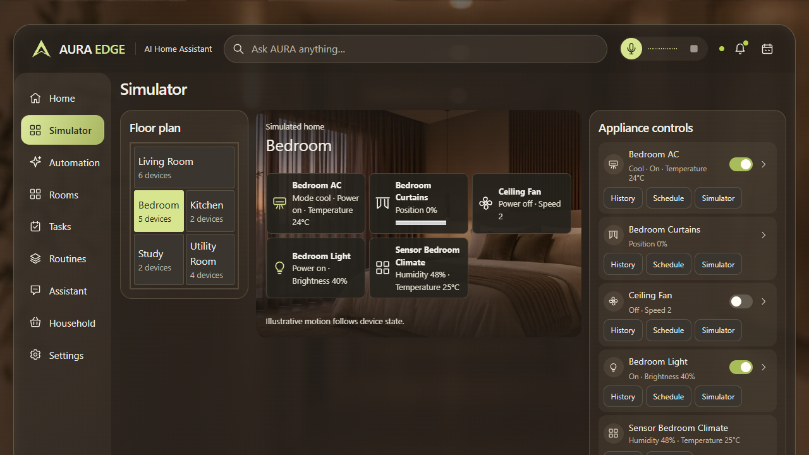

# Smart-Home Simulator Guide

```powershell
Invoke-RestMethod http://127.0.0.1:8000/api/v1/smart-home/rooms
Invoke-RestMethod http://127.0.0.1:8000/api/v1/smart-home/devices?room=bedroom
$body = @{ action='brightness'; value=42; source='ui' } | ConvertTo-Json
Invoke-RestMethod -Method Post -ContentType application/json -Body $body `
  http://127.0.0.1:8000/api/v1/smart-home/devices/light.bedroom_main/command
```

Development controls below `/api/v1/smart-home/simulator` set availability,
inject clearly labeled climate values, or force washer/vacuum completion. Inspect
authoritative state through `/history`, `/activities`, `/energy` and `/routines`.
PostgreSQL retains device state across backend restarts.

## Interactive simulator

Open Simulator in the sidebar of the desktop or the local browser dashboard. Select one of the five actual rooms in the floor plan. Device markers display the latest backend state. A running fan rotates at its reported speed, the light affects room illumination, the curtain meter follows position, and the washer and vacuum indicators move while their cycle is active. Select an appliance name to open its additional controls. Use Recent changes to compare the control source, device, action and timestamp. During an active cycle the simulator refreshes its countdown from the backend every second. Reduced motion preserves the numerical state displays.


