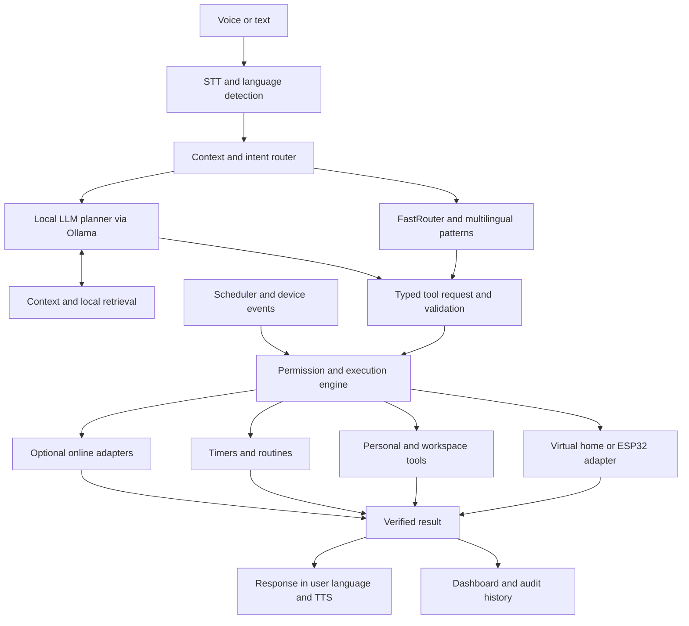

# AURA EDGE — Master engineering context

**Project:** AURA EDGE | **Challenge:** Synapse 2.0, Problem Statement 13 | **Status:** proposed prototype specification, not a claim of implemented features | **Revision:** 1.0, 25 November 2026

## 0. Instructions to Antigravity

Act as the senior software engineer responsible for an offline-first, multilingual personal AI assistant for Indian homes and workspaces. This document is the single source of truth. Read it before changing code. Work on only the explicitly authorized phase; stop after that phase's acceptance gate and report. Do not build everything from one instruction. Maintain `docs/PROGRESS.md`, `docs/DECISIONS.md`, `docs/TEST_REPORT.md` and `docs/THIRD_PARTY.md` as the implementation evolves. Keep the original AURA V4 project untouched. Never expose secrets or private data, claim untested functionality, invent benchmark results, hide failures, or substitute hardcoded demo responses for working features.

The objective is a polished, demonstrable prototype in a 24-hour competition, not a production-certified product. Prioritize reliability over feature count. The prototype must be useful before online integrations are attempted. Confirm organizer rules on pre-event work, code reuse, model preparation, external hardware and optional online demonstrations before treating any of those as permitted for submission. If reuse is not allowed, implement a clean, compliant version rather than copying existing code. Keep prototype development distinct from the competition submission.

## 1. Product vision and challenge requirements

AURA is a voice-first personal assistant that manages a user's home, daily responsibilities and local computer. It combines Alexa-style controls, personal secretary features, local document intelligence, and proactive automation. Its core intelligence must run locally on a single laptop; a GPU is optional, not required by our design. The user can speak in English, Hindi or Kannada and receive spoken replies in the same language. Mixed-language commands are a stretch goal. Optional network integrations must never undermine the offline core.

The official source is `Synapse_2.0_Problem_Statements.pdf`, page 6, Problem Statement 13, **A Voice Assistant That Works Completely Offline**. The required deliverables are: speech-to-text, varied phrasing recognition, pretend-home control, time/date, timers, spoken replies in English and Hindi or Kannada, and refusal of misunderstood requests. The statement requires a single laptop without internet; it does not specify a model or ban a GPU. It does not explicitly authorize optional online extensions or prior code reuse. Our three-language target and other features are additional engineering goals.

### Scope tiers

- P0 (non-negotiable): standalone offline voice-to-action-to-voice pipeline, all three target languages (official minimum is English plus either Hindi or Kannada), simulated devices, varied phrasings, time/date, timers, safe refusal and visible results. CPU and supported GPU modes, tested separately. No external dependencies at runtime.
- P1 (differentiation): real ESP32 light/fan/temperature over LAN, persistent memory, tasks/calendar/reminders, groceries/recipes, saved parcel and expense records, routines, real-time dashboard and measured performance.
- P2 (only after P0/P1 stability): document RAG, richer desktop automation, mobile dashboard, local media, broader appliance adapters, optional authorized online synchronization and service navigation. No payments, purchase submission or autonomous checkout at any phase.

## 2. Architecture and execution flow

Use a **layered modular monolith** with an **event-driven automation engine**. One deployable core application, organized by bounded modules, with local supporting processes (Ollama, PostgreSQL, MQTT) and optional external adapters. No mandatory microservices, cloud database or cloud LLM. Keep domain logic independent of UI and transport.

Layers: presentation (React dashboard, existing desktop island), speech (STT, language detection, TTS), intelligence (intent, context, LLM planner), application (home, personal, workspace), execution (permissions, validation, registry, result checks), data (PostgreSQL/pgvector), infrastructure (hardware and network adapters, telemetry). Event bus dispatches typed device events and scheduled jobs without an always-running LLM. Use bounded queues and cancellation so the microphone/UI remain responsive during inference. Separate internal APIs from device adapters; validate LLM outputs against schemas, never execute arbitrary model-generated shell/SQL.

### Connectivity contract

| Mode | Allowed | Required behavior |
|---|---|---|
| Strict offline (default) | Loopback/local files only | Every P0 feature works with Wi-Fi and internet disabled. No external DNS, telemetry, cloud fallback, remote fonts/assets or model downloads. |
| LAN only | Explicitly configured private-network endpoints | Same offline intelligence; physical ESP32 and phone dashboard where paired. Internet still blocked. |
| Online (opt-in, optional) | Approved external connectors only | Live refresh and official app/site navigation. Local models remain default. Credentials stay local; integrations fail gracefully and show last sync. |

Use a centrally enforced network policy, not just a UI toggle. Test using actual network isolation and outbound traffic checks; verify service binds and local paths. Local PostgreSQL/Ollama can communicate via loopback in strict mode. ESP32 may use a router without WAN or its own AP; neither is required by the simulator. Phone is a LAN client, not an independent inference host. Use authenticated pairing and restrict LAN access; use secure transport for microphone capture on phones (e.g., trusted HTTPS) if implemented.

## 3. Technical choices

| Component | Proposed stack / implementation |
|---|---|
| Frontend | React, TypeScript, Tailwind CSS, locally bundled assets; responsive dashboard |
| Desktop voice UI | Existing AURA PySide6/QML Dynamic Island, if reusable; otherwise a clean equivalent |
| Backend | Python, FastAPI, Pydantic, WebSockets for event/state updates |
| Database | Local PostgreSQL + pgvector; SQLAlchemy and Alembic migrations proposed; no SQLite substitution without approval |
| Speech recognition | Faster-Whisper multilingual Base/Small; INT8 CPU; supported GPU acceleration |
| Reasoning | Ollama local runtime; Qwen 3.5 2B and 4B quantized candidates; benchmark rather than assume winner |
| TTS | Benchmark AI4Bharat Indic Parler-TTS for EN/HI/KN; Piper where suitable voices exist; choose lightweight local alternatives if CPU latency is unacceptable |
| Intent recognition | AURA FastRouter + Hassil / multilingual patterns; optional semantic embeddings |
| RAG | Local multilingual embeddings and pgvector; exact structured queries for dates, money, states and tasks |
| Scheduler | APScheduler with persistent jobs or a tested PostgreSQL-backed scheduling approach; explicit timezone and missed-job policy |
| IoT | ESP32, MQTT broker (Mosquitto), Paho MQTT, optional ESPHome/Home Assistant adapters |
| Tool integration | Typed internal tools; reuse MCP adapters selectively, not a mandatory remote dependency |
| Telemetry | psutil and available GPU metrics (NVML on supported NVIDIA hardware) |
| Tests | pytest, API integration tests, frontend interaction tests, recorded audio benchmark suite |

Verify package/model versions, weights, licenses, OS and CPU/GPU compatibility before locking dependencies. The named models are candidates, not a guarantee of performance or compatibility. Prepare weights, dependencies, fonts and frontend build assets locally where rules permit. Do not silently replace agreed technologies; record blockers and proposed alternatives.

## 4. Voice and hardware intelligence

Support listening, transcribing, routing, execution, verification and speaking, with visible intermediate states and user cancellation. Detect or allow selection of English, Hindi, Kannada; retain language context in a conversation. Do not require English translation for all commands: normalize to language-independent typed intents. Use localized response templates for deterministic operations; use the local LLM for complex reasoning or phrasing only. TTS must pronounce numbers, device names and time correctly. Offer push-to-talk initially, then wake word and interruption if stable. No always-on raw audio retention by default.

Provide CPU-only, GPU-accelerated and Auto modes. Verify actual compute placement per component; unsupported acceleration falls back to CPU with clear status. Avoid loading multiple heavy models concurrently on low-memory systems; warm only needed models, limit context, stream output and cache common response audio if helpful. Proposed performance goals: simple action after transcription <200 ms, simple end-of-speech to first audible reply <2 s, complex reply 3–8 s. These are targets, not pass claims; report measured cold/warm latency, and revise goals if hardware cannot meet them. Test CPU operation even if GPU is present. An 8 GB configuration is a stretch target; 16 GB is a reasonable starting point to test, not a certified minimum.

## 5. Product input/output requirements

Inputs: microphone/wake word or push-to-talk, typed commands, approved local files and imports, device/sensor events, scheduled triggers. Outputs: spoken reply in selected/detected language, visible state/result/card, actual verified action or saved artifact, and an audit event. Unknown intent -> refuse or clarify; unavailable device -> explicit failure; partial routine -> report which actions worked. Distinguish requested, scheduled, acknowledged, verified, failed, and unknown states.

| Voice input example | Actual required output | Priority / mode |
|---|---|---|
| Switch on the bedroom light / bedroom ki light on karo / ಬೆಡ್‌ರೂಮ್ ಲೈಟ್ ಆನ್ ಮಾಡು | Update correct simulated device, verify state, reply in language | P0 / strict |
| Increase the fan speed; now turn it off | Resolve prior device, validate allowed speed, update | P0 / strict |
| Set AC to 24 degrees | Change target temperature within supported limits | P0 / strict |
| Dim the living-room lights to 30% | Change brightness, display new state | P0 / strict |
| What time is it? What is today's date? | System clock/timezone, spoken output | P0 / strict |
| Set a timer for 10 minutes; cancel it | Real countdown, notification/cancellation | P0 / strict |
| Do the thing over there | Clarification/refusal, no side effect | P0 / strict |
| Turn off all nonessential lights and fans | Room/group control with exclusions and verification | P1 / strict |
| Start the vacuum / how long is washing left? | Simulated cycle status, or compatible device result | P1 / strict or LAN |
| Is the fridge door open? | Report known sensor state or unavailable; don't invent | P1 / strict or LAN |
| Close the curtains, start movie mode | Configured routine, per-action results | P1 / strict or LAN |
| Turn on the physical desk light | ESP32 state confirmation; label physical adapter | P1 / LAN |
| What happened at home today? | Device activity timeline and alerts | P1 / strict |
| Which appliance used the most power? | Measured or labeled estimated energy breakdown | P1 / strict or LAN |
| Brief me about my day | Tasks, appointments, reminders, saved delivery info | P1 / strict |
| Remind me to submit my report tomorrow at 5 PM | Persistent reminder with confirmed date/time | P1 / strict |
| Add milk and eggs to the grocery list | Persisted list entries and quantities where supplied | P1 / strict |
| What groceries are we missing? | Compare recorded stock against configured minimums | P1 / strict |
| What can I cook with eggs and rice? | Local recipe suggestions, missing ingredients and optional timers | P1 / strict |
| How much did I spend this month? | Accurate sum of deduplicated imported/recorded transactions, categories and coverage | P1 / strict |
| Which parcels are coming today? | Saved expected arrivals, source and last-updated timestamps | P1 / strict |
| Open my project / find my presentation | Approved local application/file launch or search result | P1/P2 / strict |
| Summarize this PDF and create tasks | Source-grounded summary, proposed tasks then save on instruction | P2 / strict |
| Play my local playlist | Local file playback | P2 / strict |
| Find milk on Blinkit / biryani on Zomato | Prepare list or open official service for user to continue, never place order | P2 / online |
| Refresh my Amazon and Flipkart parcels | Authorized read-only refresh from order emails or permitted API | P2 / online |

The English/Hindi/Kannada examples are illustrative tests; expand with native-speaker review, independent paraphrases, transliteration, noise, accents, mixed languages, corrections, ambiguous devices, negation and unsupported requests.

## 6. Smart home and physical integration

Create a room/device registry: stable ID, room, aliases by language, type, capabilities, current state, source, last-seen timestamp, allowed ranges, adapter and connection status. Model power, level/speed, temperature setpoint, position, cycles and sensor-only readings as capabilities, not individual hardcoded command branches. Initial simulated house should include bedroom, living room, kitchen and workspace. Prioritize lights, fans, AC, curtains, TV, smart plugs, fridge, vacuum, washing machine and sensors. Extend to purifier, geyser, water tank, irrigation, locks and energy meter if stable. Security-related actions require explicit permission; never treat an ordinary appliance switch as a safety-critical control. Label virtual versus physical devices visibly.

Physical demo: low-voltage LED, DC fan with appropriate driver, and temperature/humidity sensor on ESP32. Local MQTT command/state topics, authenticated broker, correlation ID, acknowledgment, timeout, duplicate protection, last-will/offline handling and reconnect reconciliation. Verify the device-reported state, not merely message transmission; do not imply sensor-verified physical movement unless there is a sensor. Never switch mains loads in the prototype. Commercial appliance adapters are optional and require compatible documented APIs; Wi-Fi alone does not imply offline control.

Routines: morning, away, study/work, movie, night, energy-saving. Users can configure actions, exceptions and triggers. Do not turn off essential appliances indiscriminately. Sensor threshold events can trigger approved automations; deduplicate alerts and prevent feedback loops. Energy reports distinguish meter measurements from rated-wattage × runtime estimates. Simulated sensor values must be explicitly labeled, not reported as real readings.

## 7. Memory, database and proactive assistant

PostgreSQL is authoritative for persistent data. Suggested tables: users/settings, rooms/devices/device_states/device_events, routines/routine_steps, scheduled_jobs/reminders, tasks/calendar_events, preferences/memory_items, conversations/messages, documents/chunks/embeddings, groceries/inventory, expense_transactions/imports, parcels/parcel_events, notifications, action_runs and performance_samples. Define primary/foreign keys, indexes, UTC timestamps plus local timezone display, migrations, unique source IDs for import deduplication, and retention settings. Keep migrations reversible where practical and avoid redundant databases. Use local file paths with restricted access for documents.

Short-term memory retains recent context and resolved entities. Long-term memory stores user-approved preferences and durable instructions, with provenance, update/delete support and user control. Use retrieval over approved text and documents with multilingual embeddings; supply only relevant chunks to the LLM. RAG is not a substitute for exact SQL queries or scheduling. Treat retrieved content as untrusted data, not executable instructions. Avoid saving credentials, unnecessary raw audio or sensitive information by default; use OS credential storage for optional connectors, access control and encrypted storage where available.

Use persistent scheduling, event-driven alerts and local notifications. On restart, reload pending jobs, report missed reminders according to explicit policy and avoid duplicate execution; the laptop must be running/awake for real-time alerts unless separately configured. Do not replay dangerous or expired actions automatically. Examples: meeting approaching, low inventory, overdue tasks, appliance disconnection, washing completion, fridge door open (sensor required), and daily briefing. Suggest routine changes from patterns only with opt-in; ask before creating new automations.

## 8. Optional external services and boundaries

Use separate disabled-by-default adapters. Parcel information: import sample or user-provided order confirmations and authorized Gmail messages; record source, timestamp, expected arrival and last status. Offline replies explicitly say last known status and never claim live tracking. Optional authorized Gmail/Calendar synchronization only when online and permitted. No assumption of direct Amazon/Flipkart customer API access or Google Home access to financial data. Expense analysis uses manually entered or user-exported statements/receipts; deduplicate, show coverage, no banking login or payment handling. Blinkit/Zomato: local list preparation and official app/site navigation only; no automated checkout, orders, payment, OTP handling or unofficial scraping. Optional live searches must fail gracefully when unavailable. Use demo records marked as sample; never seed real personal data in public code.

## 9. Frontend and backend contract

Design a professional, responsive desktop-first dashboard with a clean dark/neutral theme and accessible contrast. No decorative widgets that pretend to function. Main areas: overview/daily briefing, interactive home (room tabs and device cards), routines/schedules, tasks/calendar, grocery/inventory/recipes, deliveries/expenses, memory/history, and performance/settings. Dynamic Island provides listening/thinking/executing/speaking/error states, mic mute, stop, language, processing and connectivity selectors; quick action confirmations. Manual and voice operations use identical backend actions. Show simulated/physical badges, connection status, freshness and error messages. Use local fonts/assets, keyboard navigation and readable multilingual text. LAN/mobile optional with paired access.

Suggested APIs: health/readiness, capabilities, typed command submission/cancellation, device listing/control, task/reminder/routine CRUD, memory management, imports, metrics; WebSocket event stream with state updates. Return request ID, status, spoken text, language, structured result, timestamp and optional error. Validate types and permissions; no arbitrary shell or raw SQL endpoints. Make external integrations clearly opt-in.

## 10. Existing code and candidate upstream references

The supplied `phase4-agent (2).zip` contains `phase4-agent/src/aura/`. Source inspection confirmed the following file names and selected indicators; runtime behavior has NOT been verified. Inspect dependencies, imports, configuration, tests and licenses before reuse. Use only allowed code, never copy the full archive blindly.

| Existing relative path under `src/aura/` | Reuse assessment |
|---|---|
| `core/mic_listener.py` | Microphone/Whisper foundation; English `base.en` references must be replaced/configured for multilingual tests |
| `core/voice.py` | Existing playback/TTS; Edge TTS and SAPI references require strict-offline audit |
| `core/fast_router.py` | To-do/focus/direct routing candidates; add typed intent validation |
| `core/providers.py`, `core/model_router.py` | Ollama/model selection candidates; Qwen 3.5 references present; isolate cloud routes |
| `core/personal_memory.py`, `core/memory.py` | Memory logic; JSONL references present; migrate selected persistence to PostgreSQL |
| `core/workspace_connector.py` | Calendar/JSON workspace logic; audit network and migrate local data |
| `core/mcp_hub.py`, `core/execution_controller.py` | Tool dispatch/execution candidates; enforce permission and offline boundaries |
| `mcp/desktop_server.py`, `mcp/filesystem_server.py`, `mcp/jarvis_server.py` | Desktop/files/personal tool candidates; allowlist operations and isolate web tools |
| `core/telemetry.py` | psutil/NVML indicators; adapt hardware monitoring and benchmark logs |
| `island.py`, `island_ui/Island.qml`, `server.py` | Existing presentation and backend entry points; evaluate reuse rather than rewrite blindly |

Candidate upstream sources (verify availability, versions, model/voice licenses and contest rules before importing): SYSTRAN/faster-whisper; OHF-Voice/piper1-gpl; OHF-Voice/intents; OHF-Voice/hassil; ollama/ollama; AI4Bharat/indic-parler-tts (model on Hugging Face); pgvector/pgvector; eclipse-mosquitto/mosquitto; eclipse-paho/paho.mqtt.python; esphome/esphome; home-assistant/core (reference/optional adapter, not required runtime); agronholm/apscheduler; Amazon MASSIVE multilingual intent dataset. Use MASSIVE and Home Assistant examples as test/pattern sources, not as private customer logs. Record provenance and licenses, preserve notices, respect GPL and model/dataset license requirements. Pin reviewed versions. No network fetch is needed during strict offline runtime.

## 11. Phase-by-phase implementation and gates

The following is a roadmap, not authorization to perform all phases. Protect P0 first. Create a local Git checkpoint after each passed gate; never push publicly without user instruction. Run regression tests from earlier phases at every gate.

| Phase | Deliverables | Acceptance gate |
|---|---|---|
| 0 — Foundation | Audit AURA V4; separate project; architecture/docs; dependency inventory; hardware inventory; FastAPI health endpoint; local PostgreSQL and pgvector migration smoke test; minimal UI shell | Original untouched; local startup documented; actual DB persistence/extension checked; no secret copying; offline policy skeleton tested; blockers explicitly recorded |
| 1 — Voice | EN/HI/KN microphone-to-STT-to-router-to-TTS, CPU/GPU selection; date/time and real timers; safe refusal | Recorded and live inputs in each language; correct spoken replies; CPU-only tests; no WAN; unsupported requests cause no actions |
| 2 — Smart home | Stateful simulator, device registry, UI cards, commands and basic routines; optional ESP32 adapter | Voice and manual actions update same state; varied commands and ambiguity tests; device state verification; offline simulator passes independently; real hardware test if present, otherwise mark pending |
| 3 — Memory & events | PostgreSQL preferences/history, local retrieval, scheduler, notification bus, restart behavior | Save/restart/retrieve/edit/delete; persistent jobs and deduplication; exact facts from structured data; no outbound dependencies |
| 4 — Personal assistant | Tasks, calendar, briefings, groceries, recipes, expense import, cached parcels, selected desktop/file tools | Real CRUD, import provenance and totals, no fabricated parcel updates, approved operations only; voice-driven workflow passes |
| 5 — UI | Full dashboard, island, real-time updates, analytics and optional paired phone interface | No dead controls; manual and voice sync; visual and accessibility checks; offline assets; explicit failure/status labels |
| 6 — Optional online | Authorized read-only sync and official-site handoff; never order/pay | Explicit opt-in, source timestamps, no credentials in logs, network-loss fallback; skip if rules/time prohibit |
| 7 — Verification | Regression, security/privacy, end-to-end offline and LAN demonstrations, benchmarks, setup guide and presentation evidence | All P0 acceptance tests pass or issues disclosed; reproducible commands and genuine logs; no invented numbers; demo survives blocked internet |

Suggested 24-hour allocation if rules permit the planned scope: Phase 0: 2h, Phase 1: 4h, Phase 2: 5h, Phase 3: 3h, Phase 4: 3h, Phase 5: 3h, Phase 6: optional 1h, Phase 7: 3h. These are planning budgets, not guaranteed completion times. Run tests continuously; defer P2 before sacrificing P0. If Kannada neural TTS is slow, benchmark lightweight local voices immediately rather than dropping language silently.

## 12. Benchmarking and demonstration

Compare CPU-only and supported GPU configurations on the same laptop using the same model, quantization, audio files, prompt, context, output length and generation settings. Compare different model sizes separately. Test cold and warm starts; repeat trials; report median and p95, peak RAM/VRAM, CPU/GPU use, STT word/character error by language, intent/slot accuracy, verified action success, false action rate on unknown commands, LLM tokens/sec, TTS time to first audio and full end-to-end response latency. Record exact hardware, versions, trial count, logs and methodology; no made-up results. Test no GPU, no WAN, disconnected device, invalid command, restart, scheduler missed event and offline startup. Use real recorded utterances in all languages; mock tests do not count as live hardware or speech validation.

Demo sequence: (1) disable Wi-Fi and internet, launch offline core; (2) speak English, Hindi and Kannada, control virtual appliances, set timer, ask date/time, demonstrate refusal; (3) create grocery/task/reminder, restart and recall; (4) optionally enable isolated LAN, control physical LED/fan and view sensor; (5) demonstrate CPU vs GPU using actual measurements and show usage/latency plots; (6) only if allowed, enable online adapter and show read-only sync or app handoff. No payment or purchase. Clearly distinguish simulated, measured, estimated, cached and live values.

## 13. Required outputs per phase

For each phase provide: changed-file list, exact startup and test commands, test results with pass/fail counts, evidence/logs, known limitations, security/compatibility notes, dependency changes, Git checkpoint if allowed, and the next phase's prerequisites. Do not mark a phase complete if a required test is unrun or failing. Record unavailable hardware/models as blockers, not fake success. Keep README instructions simple enough to reproduce on the target Windows laptop. Never publish `.env`, keys, private memory, chat histories, real order/expense records, caches, model weights or unrelated reference trees.

**Current authorization: Phase 0 only. Read the companion `AURA_EDGE_PHASE_0_PROMPT.md`. All other phases require the user's next instruction.**
